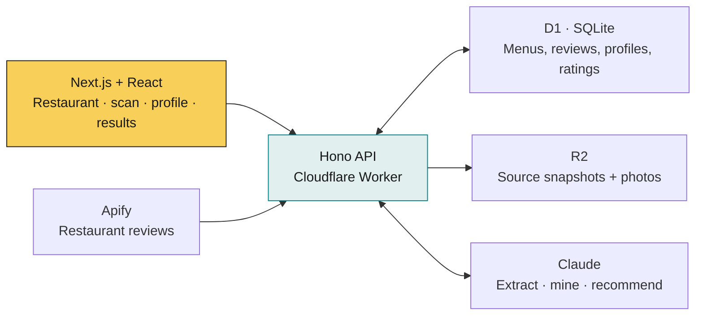

# What's Good

**At the restaurant. Menu in hand. What should I order?**

Pick a restaurant or import its menu. Get up to three dishes for your preferences, with stored prices and checked review evidence. Thin evidence and fallback rankings are labelled.

[How it works](#how-it-works) · [Run locally](#run-locally) · [Tests & metrics](#tests--metrics) · [Product validation](#product-validation)

## How it works

**Choose / scan → set allergies, diet, budget & taste → get picks → rate your meal**



| Frontend · [`web/`](web/) | Backend · [`api/src/`](api/src/) |
|---|---|
| Next.js static export → Cloudflare Pages | Hono routes → Cloudflare Workers |
| Restaurant search; shared profile and scanner dialogs; results and meal ratings | Menu URL/PDF/photo extraction; review collection and dish-mention mining |
| Photos resized to ≤2400px and converted to JPEG before upload | D1 stores structured records; R2 stores source files |
| Plain ranking appears while model picks load; stale responses are ignored | Menu, restriction, budget, quote-attribution and distinct-review-count checks |
| Keyboard navigation, focus restoration and responsive layouts | Up to 3 validation attempts, then plain ranking without generated reasons/quotes |

Confirm allergies with your server; ingredient data can be incomplete. Failed menu/evidence replacements preserve previous usable data.

## Run locally

**Node.js 22+ · npm · Microsoft Edge**. Tests use isolated fixtures/mocked model calls; no keys needed. Local D1/R2 need no Cloudflare account.

```bash
npm ci
npm test                         # API + web unit/integration tests
npm run e2e -w web               # Builds the web app; runs Edge browser tests
```

<details>
<summary>Run the live app with your own keys</summary>

Set `ANTHROPIC_API_KEY` and `APIFY_TOKEN` in the copied, git-ignored file:

```bash
cp api/.dev.vars.example api/.dev.vars
# After filling in the keys, terminal 1:
cd api
npx wrangler d1 migrations apply whats-good --local
npm run dev
```

```bash
# Terminal 2, from the repository root:
node scripts/seed-demo.mjs http://localhost:8787  # Fetches real data; uses your service limits
NEXT_PUBLIC_API_URL=http://localhost:8787 npm run dev -w web
```

Open **[localhost:3000](http://localhost:3000)**; API: **8787**.

</details>

<details>
<summary>Optional: use your own Claude login locally</summary>

Sign in with `claude`; run `npm run bridge -w api`. Set `LLM_BRIDGE_URL=http://127.0.0.1:8790` in `api/.dev.vars`, then restart the API. This uses your plan limits; Apify is still needed. The bridge is local-only; deployed/shared use requires an API key. Reports disclose bridge usage.

</details>

## Tests & metrics

**382 automated cases** · **363/363 unit + integration passed** · **19/19 browser passed**

Measured **2026-11-05** · [Passing CI](https://github.com/krishpatel17/WhatsGood/actions/runs/42038050531)

| Layer | Cases | How / what it checks |
|---|---:|---|
| API | 320 | Vitest: routes, rollback/concurrency, evidence, SDK/bridge contracts, benchmarks. Includes **workerd + D1 + R2** integration. |
| Web components | 43 | Vitest + Testing Library/jsdom: request races, storage, recovery, dialogs and keyboard behavior. |
| Browser | 19 | Playwright: diner flows, synthetic-image decoding/JPEG upload, focus, responsive layouts, visual comparisons. **Edge locally; Chromium in CI.** |

**CI on every push:** `npm ci` → tracked-text credential scan → tests + V8 coverage → production web build + browser tests → coverage artifacts. A failed check fails the job.

| V8 coverage | API | Web |
|---|---:|---:|
| Measured lines | **96.49%** | **89.65%** |
| Minimum lines / statements | 90% / 90% | 75% / 75% |
| Minimum functions / branches | 85% / 80% | 70% / 65% |

**Line coverage = executed ÷ eligible instrumented lines.** Scope: `api/src/**` except declarations; `web/components/**` + `web/lib/**`. Browser tests exercise Next page wiring separately. These percentages exclude CLI/root scripts: [coverage scope & limits](docs/test-review.md#coverage-scope-and-enforcement).

```bash
npm run coverage                 # Runs tests and enforces all coverage minimums
npm run typecheck -w api
npx tsc --noEmit --incremental false -p web/tsconfig.json
node scripts/metrics.mjs > docs/metrics.md  # Refresh counts; also runs suites and queries GitHub
```

**Reporting tags: 223 `[ai]` / 159 `[manual]`.** Reviewed follow-ups count as manual by team request; implementation used AI assistance. [Metrics](docs/metrics.md) · [Scenarios & attribution](docs/test-review.md)

## Product validation

**Alpha verdict: Invalidated.** Import missed its target despite passing software tests. [Full report](validation/REPORT.md)

| Experiment | Measure | Recorded result |
|---|---|---|
| **A1 · Sources exist** | At least 24 of 30 restaurants have readable menu sources | **PASS · 25/30** |
| **A2 · Import works** | At least 8/10 menus pass; pooled dish-accuracy bootstrap lower bound ≥90% | **FAIL · 5/10**, lower bound **64.8%** |
| **A3 · Reviews mention dishes** | At least 8/10 restaurants have ≥3 dishes with ≥3 matched review mentions each | **PASS · 9/10** |

**10 scored menus = 5 medium + 5 hard**, plus one easy demo. [Tiers fixed before importing](validation/a2-benchmark/manifest.json):

| Tier | Source-format rule | In the set |
|---|---|---:|
| Easy | Clean HTML menu with prices | 1 demo, unscored |
| Medium | Text PDF or long HTML menu with 60+ items | 3 PDFs + 2 long HTML |
| Hard | Image-only menu or JavaScript ordering page | 1 image menu + 4 ordering pages |

**Difficulty describes source format, not import success.** A menu passes with **≥95% correct names/prices, zero invented dishes, <120 seconds, no manual fixes**. Accuracy = correct name/price matches ÷ answer-key dishes; unmatched extractions count as invented.

Humans copy answer keys and independently spot-check 20%. Prompts are Git-tag frozen. Statistics: exact restaurant-level intervals and 10,000 restaurant-cluster bootstrap resamples. Photo scanning is outside A2.

Benchmark commands, service requirements and human-labelling steps: [reproduce A2/A3](validation/a2-benchmark/README.md). Acceptance criteria: [PLAN.md](PLAN.md).

<details>
<summary>Deploy API + frontend</summary>

Create D1 and put its ID in `api/wrangler.toml`:

```bash
cd api
npx wrangler d1 create whats-good
# Set database_id in wrangler.toml, then:
npx wrangler r2 bucket create whats-good-menus
npx wrangler d1 migrations apply whats-good --remote
npx wrangler secret put ANTHROPIC_API_KEY
npx wrangler secret put APIFY_TOKEN
npm run deploy
```

From the repository root, replace the API URL with your deployed Worker URL:

```bash
cd web
NEXT_PUBLIC_API_URL=https://whats-good-api.<your-account>.workers.dev npm run build
npx wrangler pages deploy out --project-name whats-good
```

Smoke check from the root: `node scripts/smoke.mjs <deployed-api-url>`.

</details>

**Explore:** [Product brief](PRODUCT.md) · [Design](DESIGN.md) · [Stories & protocol](PLAN.md) · [Prompts](api/src/prompts/) · [Validation tooling](api/src/validation/) · [Original pitch](readme-startupSelected.md)
